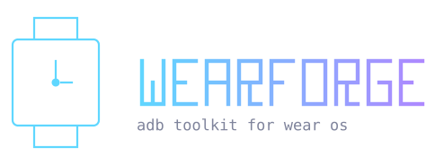

<div align="center">



Debloat, tweak and manage your Wear OS watch from the terminal.

[](https://github.com/dmitthedazed/wearforge/actions/workflows/ci.yml)
[](LICENSE)

</div>

## Install

Linux, macOS, Termux:

```sh
curl -fsSL https://raw.githubusercontent.com/dmitthedazed/wearforge/main/install.sh | sh
```

Windows (PowerShell):

```powershell
irm https://raw.githubusercontent.com/dmitthedazed/wearforge/main/install.ps1 | iex
```

The installer pulls in Python and adb if they're missing, then puts `wearforge` on your PATH.

<details>
<summary>Manual install</summary>

Needs Python 3.9+ and [adb](https://developer.android.com/tools/adb).

```sh
pipx install git+https://github.com/dmitthedazed/wearforge.git
```

</details>

## Features

- Wireless pairing, USB, reconnect from history
- Device diagnostics: model, Android version, battery, storage, screen
- Debloat from a curated catalog (Galaxy Watch, Pixel Watch), the [UAD-NG](https://github.com/Universal-Debloater-Alliance/universal-android-debloater-next-generation) database, or a manual package picker
- Restore anything you disabled or removed
- Sideload and back up APKs, push and pull files
- Display, font, audio and input tweaks, screenshots, screen recording
- Reboot modes, cache cleanup, watch optimizer, ADB shell

Debloating disables packages by default (`pm disable-user`) instead of uninstalling them, and every change is logged, so you can undo it from the Restore menu.

## Connect your watch

1. Settings → System → About → Software info: tap the build number 7 times.
2. Developer options: turn on ADB debugging and Wireless debugging.
3. Wireless debugging → Pair new device, then enter the IP, port and code in `Connect / Pair`.

## Usage

```sh
wearforge
wearforge -d 192.168.1.42:5555
```

<details>
<summary>All options</summary>

| Flag | |
| --- | --- |
| `-d`, `--device SERIAL` | Connect to this serial or `IP:PORT` on startup |
| `--no-auto-connect` | Don't pick the first connected device automatically |
| `--update-uad` | Update the UAD-NG database and exit |
| `-v`, `--verbose` | Print debug logs to the console |
| `--version` | Show version |

</details>

<details>
<summary>Data and logs</summary>

Backups, screenshots, recordings, history and the log file live in:

| OS | Path |
| --- | --- |
| Linux | `~/.local/share/wearforge` |
| macOS | `~/Library/Application Support/WearForge` |
| Windows | `%LOCALAPPDATA%\WearForge` |

Set `WEARFORGE_DATA_DIR` to use a different folder. Attach `wearforge.log` when reporting a bug.

</details>

<details>
<summary>Development</summary>

```sh
pip install -e ".[dev]"
pytest
```

See [CONTRIBUTING.md](CONTRIBUTING.md).

</details>

> [!WARNING]
> Disabling system packages can break things on your watch. Use at your own risk.

## License

[MIT](LICENSE) © Dmytrii Savin
